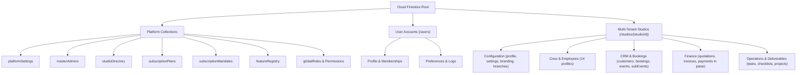

# 🗄️ STUDIO OS — FIRESTORE DATABASE ARCHITECTURE & SCHEMA SPECIFICATION

**Connected Project**: `studio-os-live-2026` (Studio OS Live)  
**Database**: `(default)` (Standard Native Firestore)  
**Region**: Multi-Region / High Availability  
**Storage Bucket**: `studio-os-live-2026.firebasestorage.app`  
**Security Model**: Role-Based Access Control (RBAC) & Multi-Tenant Studio Isolation

---

## 1. High-Level Hierarchy

Studio OS implements a strict multi-tenant database topology divided into three primary tiers:

---

## 2. Platform-Level Collections

These collections are maintained centrally by the Platform Master Admin:

### A. `platformSettings`
- **Document Path**: `/platformSettings/general`
- **Fields**:
  - `platformName`: string (`"Studio OS Platform"`)
  - `version`: string (`"2.0.0"`)
  - `maintenanceMode`: boolean
  - `defaultCurrency`: string (`"INR"`)
  - `defaultTimezone`: string (`"Asia/Kolkata"`)
  - `maxStorageQuotaMb`: number (`51200`)
  - `enforceMandatoryUPIAutoPay`: boolean (`true`)
  - `updatedAt`: timestamp

### B. `masterAdmins`
- **Document Path**: `/masterAdmins/{adminUid}`
- **Fields**:
  - `id`: string (`"usr_master_admin_primary"`)
  - `email`: string (`"admin@studio-os.com"`)
  - `displayName`: string (`"Platform Master Owner"`)
  - `roleId`: string (`"master_super_admin"`)
  - `status`: string (`"active"`)
  - `createdAt`: timestamp
  - `updatedAt`: timestamp

### C. `studioDirectory`
- **Document Path**: `/studioDirectory/{studioId}`
- **Fields**:
  - `studioId`: string (`"studio_shreeji_films"`)
  - `name`: string (`"SHREEJI FILMS AND PHOTOGRAPHY"`)
  - `ownerEmail`: string (`"aarav@shreejifilms.in"`)
  - `ownerName`: string (`"Aarav Patel"`)
  - `city`: string (`"Ahmedabad"`)
  - `state`: string (`"Gujarat"`)
  - `country`: string (`"India"`)
  - `lifecycleStatus`: string (`"active"`)
  - `visibility`: string (`"visible"`)
  - `planId`: string (`"studio_os_monthly"`)
  - `monthlyPriceInr`: number (`500`)
  - `subscriptionStatus`: string (`"active"`)

### D. `subscriptionPlans`
- **Document Paths**:
  - `/subscriptionPlans/plan_monthly_starter` (₹500/mo)
  - `/subscriptionPlans/plan_quarterly_pro` (₹1,350/qtr)
  - `/subscriptionPlans/plan_annual_enterprise` (₹4,800/yr)
- **Fields**:
  - `id`: string
  - `name`: string
  - `pricePaise`: number (integer paise)
  - `billingPeriod`: string (`"monthly"` | `"quarterly"` | `"annual"`)
  - `features`: array of strings

### E. `subscriptionMandates`
- **Document Path**: `/subscriptionMandates/{mandateId}`
- **Fields**:
  - `id`: string (`"mandate_shreeji_autopay"`)
  - `studioId`: string (`"studio_shreeji_films"`)
  - `status`: string (`"ACTIVE"`)
  - `umn`: string (NPCI Unique Mandate Number, e.g. `"UMN-SHR-2026-92810"`)
  - `monthlyFeeInr`: number (`500`)
  - `gatewayMode`: string (`"simulated_live_ready"`)

### F. `featureRegistry`
- **Document Paths**: `/featureRegistry/feat_{featureKey}`
- **Features Cataloged**: 18 modular feature toggles governing navigation, RBAC, and subscription tier visibility.

### G. `globalRoles` & `globalPermissions`
- Master, Owner, Manager, Lead Photographer, Cinematographer, Photo Editor, Video Editor, Album Designer, Drone Operator, Assistant.

---

## 3. Global User Identity Schema (`/users/{uid}`)

Centralized identity layer linking Firebase Authentication accounts to multi-studio memberships:

- **Document Path**: `/users/{uid}`
- **Fields**:
  - `uid`: string (Firebase Auth User ID)
  - `email`: string
  - `username`: string
  - `displayName`: string
  - `accountType`: string (`"MASTER_ADMIN"` | `"STUDIO_OWNER"` | `"EMPLOYEE"`)
  - `accountStatus`: string (`"active"` | `"suspended"`)
  - `defaultStudioMembership`: string
  - `createdAt`: timestamp
  - `lastLogin`: timestamp

### Subcollections:
- `/users/{uid}/memberships/{studioId}`
- `/users/{uid}/preferences/default`
- `/users/{uid}/notifications/{notifId}`
- `/users/{uid}/loginHistory/{logId}`

---

## 4. Multi-Tenant Studio Schema (`/studios/{studioId}`)

Every photography business entity is isolated under `/studios/{studioId}`.

### Production Canonical Tenant
- **Studio ID**: `studio_shreeji_films`
- **Legal Entity**: **SHREEJI FILMS AND PHOTOGRAPHY**
- **Registered Address**: 301, Titanium One, SG Highway, Bodakdev, Ahmedabad, Gujarat - 380054
- **GSTIN**: `24AAACR1122D1Z4`
- **Owner**: Aarav Patel (`aarav@shreejifilms.in`)

### A. Studio Configuration Subcollections
- `/studios/{studioId}/profile/profile`
- `/studios/{studioId}/settings/settings`
- `/studios/{studioId}/branding/branding`
- `/studios/{studioId}/branches/{branchId}`
- `/studios/{studioId}/subscription/current`
- `/studios/{studioId}/featureOverrides/overrides`
- `/studios/{studioId}/members/{uid}`
- `/studios/{studioId}/departments/{deptId}`

### B. Employees Subcollection (`/studios/{studioId}/employees/{employeeId}`)
- `id`: string (e.g. `emp_shr_rahul`)
- `userId`: string (`usr_emp_shr_rahul`)
- `employeeNumber`: string (e.g. `EMP-SHR-001`)
- `fullName`: string
- `email`: string (`@shreejifilms.in`)
- `phone`: string (`+91 98251 100xx`)
- `department`: string (`Photography`, `Cinematography`, `Drone`, `Photo Editing`, `Video Editing`, `Album Designing`, `Production`)
- `designation`: string
- `joiningDate`: string (`YYYY-MM-DD`)
- `employmentStatus`: string (`"active"`)
- `skills`: array of strings
- `monthlySalaryPaise`: number (integer paise)
- `monthlySalary`: number (INR)
- `dailyRatePaise`: number (integer paise)
- `dailyRate`: number (INR)
- `isDemoData`: boolean (`true`)

### C. Customers Subcollection (`/studios/{studioId}/customers/{customerId}`)
- `id`: string (`cust_shr_001` .. `cust_shr_026`)
- `name`: string
- `phone`: string
- `email`: string
- `city`: string (Ahmedabad, Gandhinagar, Surat, Vadodara, Rajkot, etc.)
- `fullAddress`: string
- `totalRevenuePaise`: number
- `isDemoData`: boolean

### D. Bookings Subcollections (`/studios/{studioId}/bookings/{bookingId}` and `/studio_bookings_v2/{bookingId}`)
- `id`: string (`bkg_shr_001` .. `bkg_shr_026`)
- `bookingNumber`: string (`SHR-BKG-2026-001`)
- `customerId`: string
- `customerName`: string
- `eventType`: string (All 25 categories)
- `primaryDate`: string
- `status`: string (`completed`, `deal_confirmed`, `in_production`, `editing`, `partially_delivered`, `advance_pending`, `negotiation`, `cancelled`)
- `financials`:
  - `quotedAmountPaise`: number
  - `negotiatedDiscountPaise`: number
  - `finalAgreedAmountPaise`: number
  - `advancePaymentReceivedPaise`: number
  - `balanceRemainingPaise`: number
  - `paymentStatus`: string (`"Paid"` | `"Partial"` | `"Pending"`)
  - `paymentMethod`: string
  - `transactionReference`: string
- `deliverables`: photo, video, reel, and album delivery counts and statuses
- `crew`: array of assigned employee objects `{ id, name, role }`
- `isMultiEvent`: boolean

### E. Events & Sub-Events Subcollections
- `/studios/{studioId}/events/{eventId}`: Main event record
- `/studios/{studioId}/subEvents/{subEventId}`: Multi-function sub-events (Engagement, Mandvo, Haldi, Mehndi, Sangeet, Wedding, Reception) with dedicated venue, timings, required crew count, and equipment instructions.

### F. Tasks Subcollection (`/studios/{studioId}/tasks/{taskId}`)
- `id`: string
- `taskNumber`: string (`TSK-SHR-...`)
- `eventId`: string
- `eventName`: string
- `title`: string
- `description`: string
- `assignedToId`: string (linked to Employee ID)
- `assignedToName`: string
- `department`: string
- `priority`: string (`"High"` | `"Medium"` | `"Low"`)
- `status`: string (`"Completed"` | `"In Progress"` | `"Not Started"`)
- `dueDate`: string
- `checklist`: array of checklist items `{ id, text, completed }`

### G. Financial Records Subcollections
- `/studios/{studioId}/quotations/{quotationId}`: Preserved original quotation with discount adjustments
- `/studios/{studioId}/invoices/{invoiceId}`: Tax invoice with itemized breakdown and remaining balance
- `/studios/{studioId}/payments/{paymentId}`: Verified payment transactions with receipt numbers and bank reference IDs

---

## 5. Security Rules & Indexing Summary

1. **Strict Multi-Tenant Boundary**: Access to `/studios/{studioId}/...` requires verified membership or Platform Master Admin authorization.
2. **Field-Level Data Protection**: Salaries and banking details restricted to Studio Owners and Accountants.
3. **Optimized Compound Indexes**: Composite indexes deployed on `(status, startDate)`, `(category, startDate)`, `(assignedToId, dueDate)`, `(status, paymentDate)`.
